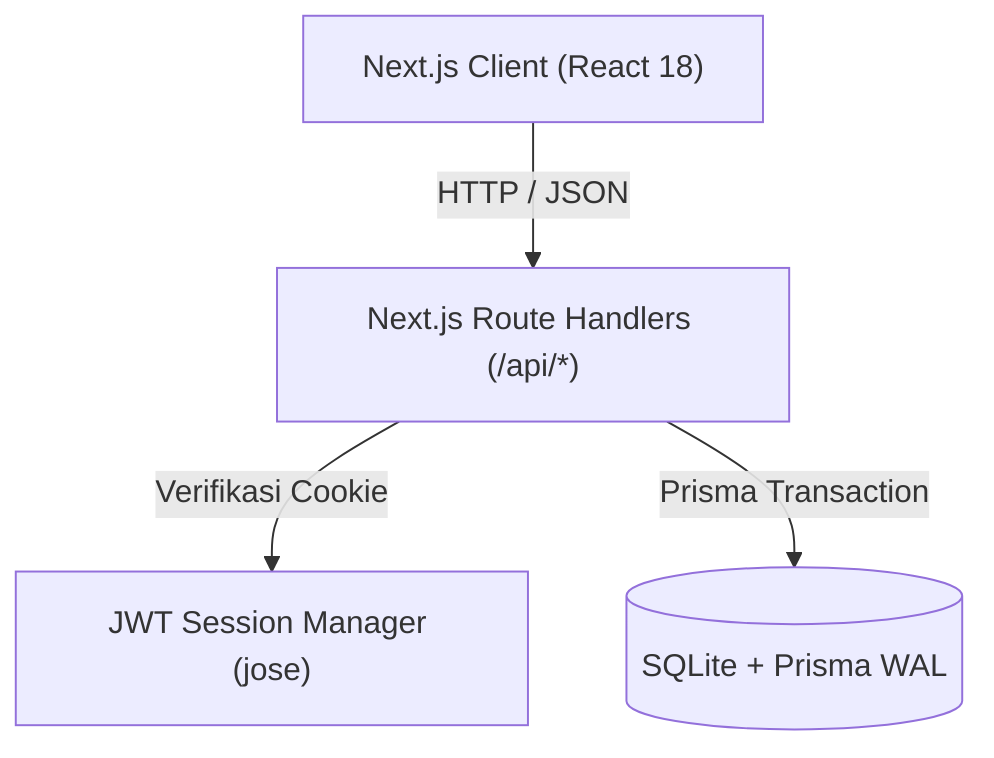

# Arsitektur Sistem DEBATE GENERATICS 2026

## 1. Ikhtisar Sistem
DEBATE GENERATICS 2026 adalah platform undian mosi, penentuan posisi debat (PRO/KONTRA), serta pengatur waktu persiapan (case-building) resmi untuk kompetisi debat tahunan Generatics.

Aplikasi ini dibangun menggunakan tumpukan teknologi modern:
- **Framework:** Next.js 14 (App Router) dengan TypeScript.
- **Styling:** Tailwind CSS dengan cosmic design system (Twinkle, Twinkle celestial theme).
- **Animasi & Interaksi:** Framer Motion dan Canvas Confetti.
- **Audio Engine:** Sintesis Web Audio API kustom (bebas file audio eksternal).
- **ORM & Database:** Prisma ORM dengan SQLite (mode WAL aktif).
- **Process Manager:** PM2 cluster mode untuk produksi 24/7 di macOS.

## 2. Pola Arsitektur Client & Server
Platform memisahkan tanggung jawab secara tegas antara komponen klien yang kaya interaktivitas visual dan API backend yang menjamin konsistensi data secara atomik.

## 3. Sinkronisasi Data & Real-Time Polling
Untuk menjaga status peserta tetap sinkron dengan keputusan admin (seperti pembukaan gerbang spin dan reset undian):
- Peserta memvalidasi sesi secara berkala via endpoint `/api/auth/me?role=participant&_t={timestamp}`.
- Header `cache: no-store` dan timestamp query param diterapkan di setiap pemanggilan untuk menghindari cache proxy browser.
- Saat admin melakukan reset, klien peserta mendeteksi perubahan `hasSpun: false` dan secara otomatis mengosongkan state hasil undian serta cache timer lokal.
