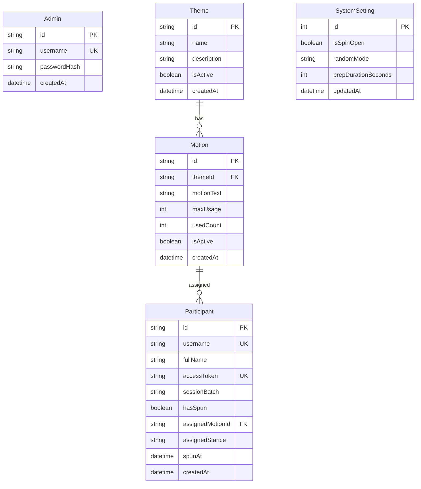

# Spesifikasi Skema Basis Data SQLite & Prisma ORM

## Model Relasional
Aplikasi menggunakan Prisma ORM dengan SQLite sebagai engine basis data persisten.

## Karakteristik Tabel Utama

### 1. Model `Participant`
Menyimpan identitas unik peserta debat:
- `username`: NIM atau ID unik peserta.
- `accessToken`: Token akses 4 karakter terenkode (format: `STR-XXXX`).
- `sessionBatch`: Sesi pelaksanaan (`Day 1` atau `Day 2`).
- `hasSpun`: Flag boolean proteksi single-spin.
- `assignedMotionId`: Relasi ke mosi terpilih (`SetNull` saat mosi dihapus).
- `assignedStance`: Posisi debat terpilih (`PRO` atau `KONTRA`).
- `spunAt`: Timestamp presisi penguncian hasil undian.

### 2. Model `Theme` & `Motion`
- Relasi `Theme -> Motion` bersifat `Cascade Delete`: penghapusan tema menghapus seluruh mosi di bawahnya.
- Atribut `usedCount`: Menghitung berapa kali mosi telah diundi oleh peserta aktif.
- Atribut `maxUsage`: Membatasi frekuensi maksimal mosi dapat diundi sebelum statusnya otomatis nonaktif.

### 3. Konfigurasi SQLite WAL (Write-Ahead Logging)
Untuk menangani akses konkuren tinggi dari banyak peserta secara bersamaan tanpa file lock:
- `PRAGMA journal_mode = WAL;` diaktifkan saat server boot.
- `PRAGMA busy_timeout = 5000;` mencegah `SQLITE_BUSY` saat terjadi transaksi bersamaan.
